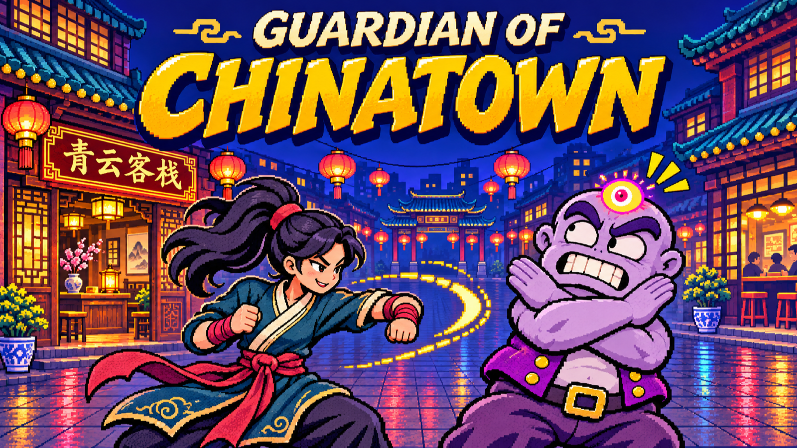

# Guardian of Chinatown

English · [简体中文](README.zh-CN.md)

A two-button arcade fighter against a monster that learns your habits.

**[Play in your browser](https://guardian-of-chinatown-alexfanzong.vercel.app)**

[](https://guardian-of-chinatown-alexfanzong.vercel.app)

Chinatown's lanterns are going out. Choose left or right, break the monster's reads, and get the street back.

## How to play

| Action | Keyboard | Touch |
| --- | --- | --- |
| Left punch | **A** or **←** | Tap the left half |
| Right punch | **D** or **→** | Tap the right half |
| Pause | **Esc** | Tap the pause button |

The monster commits to a guess before you punch. Fool it three times in a row for a **Mind Break** bonus hit. At half health, choose guaranteed healing from tea or take a chance with the elixir. Both fighters start with 12 HP. A rematch clears the monster's memory.

Play at your own pace. Sound is optional; the pause menu also has a reduced-motion setting.

## Try a different rhythm

Alternate hands. Repeat a short loop. Change your pattern halfway through. After the fight, **See the reads** shows what the monster predicted before each punch.

No account, download, or API key is needed to play. The game runs in your browser, with all game assets bundled locally. There is no gameplay telemetry or saved player history.

## Run locally

Use Node.js **22.12 or newer** and npm.

```sh
npm ci --ignore-scripts
npm run dev
```

Open the local address printed by Vite. Other commands:

```sh
npm test         # Game rules and fight-code checks
npm run build    # Static site in dist/
npm run preview  # Preview the built site locally
```

The static build works on Vercel and other static hosts. No backend or environment variables are required. The development server binds to your own computer by default.

## Under the hood

React, TypeScript/JavaScript and Vite. A small probability model learns from recent punches. The optional in-game **The experiment** page has the simulation results; [the short technical note](docs/research.md) explains their scope.

## Contributing

Bug reports and pull requests are welcome. Include your browser, device and steps to reproduce a bug. Run `npm run check` before opening a pull request. Please avoid adding accounts, analytics or remote assets to the core game.

## Credits and license

Created by [Alex Fan](https://github.com/alexfanzong), with AI assistance in implementation and artwork.

Source is available for personal, non-commercial use and learning. Commercial use and publishing modified versions require the author’s written permission. See the [license](LICENSE) and [asset notes](docs/credits.md).
