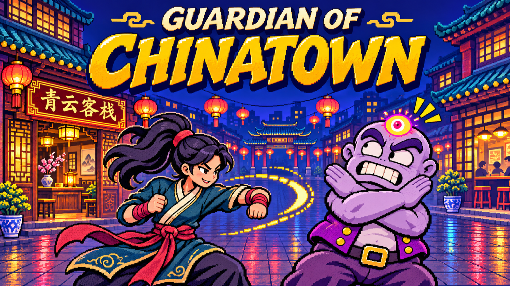

# 守护唐人街 · Guardian of Chinatown

[English](README.md) · 简体中文

只用左右两拳，挑战一个会学习你出招习惯的怪物。

**[打开网页，直接玩](https://guardian-of-chinatown-alexfanzong.vercel.app)**

[](https://guardian-of-chinatown-alexfanzong.vercel.app)

唐人街的灯笼正在熄灭。选择左拳或右拳，骗过怪物的预判，把街坊的生活赢回来。

## 怎么玩

| 动作 | 键盘 | 触屏 |
| --- | --- | --- |
| 左拳 | **A** 或 **←** | 点画面左半边 |
| 右拳 | **D** 或 **→** | 点画面右半边 |
| 暂停 | **Esc** | 点暂停按钮 |

每次出拳前，怪物都要先猜一边。连续三次骗过它，触发**破心连击**。半血时，喝茶稳回血，或选葫芦赌一次。双方各有 12 格血；重新开局，怪物也会从头学习。

不用抢时间，按自己的节奏出拳。声音默认关闭，暂停菜单里可以开启声音或减少画面运动。

## 换个节奏试试

左右交替、重复一个短循环，或者打到一半换招。赛后点 **See the reads**，可以回看怪物每拳之前的猜测。

试玩不需要注册、下载或 API 密钥。游戏在浏览器里运行，素材随网页一起加载；不收集游戏行为，也不保存玩家历史。

## 在本机运行

需要 Node.js **22.12 或更新版本**和 npm。

```sh
npm ci --ignore-scripts
npm run dev
```

在浏览器打开 Vite 显示的本机地址。其他命令：

```sh
npm test         # 检查游戏规则和对局码
npm run build    # 生成 dist/ 静态网站
npm run preview  # 在本机预览构建结果
```

可以把静态构建部署到 Vercel 等平台，无需后端或环境变量。开发服务器默认只在本机开放。

## 想了解原理

项目使用 React、TypeScript/JavaScript 和 Vite。怪物用一个小型概率模型学习最近的出拳。游戏里的 **The experiment** 是可选阅读；[技术说明](docs/research.md)记录了模拟结果的适用范围。

## 参与改进

欢迎提交问题或 Pull Request。反馈问题时，请写明浏览器、设备和复现步骤；提交代码前运行 `npm run check`。核心游戏保持无需账号、无行为统计、无远程素材依赖。

## 作者与许可

[Alex Fan](https://github.com/alexfanzong) 创作，AI 协助完成程序和美术。

源码公开，允许个人非商业试玩和学习；商业使用、修改后再发布，须另行取得作者书面许可。详见[使用许可](LICENSE)与[素材说明](docs/credits.md)。
